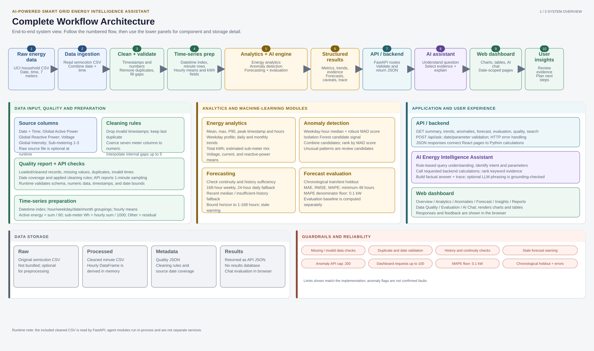
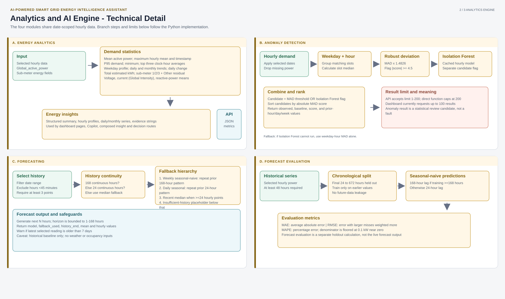
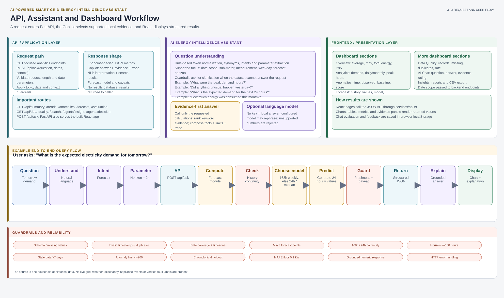

# AI-Powered Smart Grid Energy Intelligence Assistant

## Complete Workflow Architecture

[Open or download the 3-page architecture PDF](project-architecture.pdf) · [PDF generator source](generate_pdf.py) · [Diagram source generator](build_diagrams.py)

The PDF is organized as three presentation sheets: complete system overview, analytics and ML internals, and the API / assistant / dashboard workflow.

### 1. Complete system overview

### 2. Analytics and AI engine details

### 3. API, assistant, dashboard, and example query

## Implementation notes

These diagrams describe the code in this repository. They distinguish implemented behavior from architecture concepts that could be mistaken for features:

- The cleaned minute-level CSV and quality report are included. The original UCI source file is optional and is not bundled.
- The quality report stores cleaning counts, rules, and date coverage. The `/api/data-quality` response additionally reports the one-minute sampling frequency.
- Hourly data is derived and cached in process. Forecast and analytics responses are returned as JSON; there is no backend results database. Copilot ratings and evaluation entries are saved in browser `localStorage`.
- The anomaly endpoint allows a result limit up to 200; the dashboard requests up to 100. Anomaly candidates are not confirmed equipment faults.
- Forecast evaluation uses a chronological holdout and a seasonal-naive comparison implemented in `analytics.py`; it is separate from the forecast endpoint's selected weekly/daily/median strategy.
- `agents.ask()` coordinates local Python functions. The named agent roles do not run as separate services or autonomous processes. An optional LLM can rephrase a computed answer, with a check against unsupported numbers.
- Dataset coverage is one household of historical readings. There is no live grid feed, weather, occupancy, appliance-event history, or verified fault labels.

## Main implementation files

| Area | Files |
| --- | --- |
| Runtime and HTTP API | `run.py`, `energy_assistant/api.py` |
| Preparation and data loading | `energy_assistant/preprocess.py`, `energy_assistant/data.py` |
| Analytics and ML | `energy_assistant/analytics.py`, `anomaly.py`, `forecasting.py`, `fallbacks/` |
| Assistant, guardrails, and search | `energy_assistant/agents.py`, `nlp.py`, `guardrails/`, `keyword_search.py`, `llm.py` |
| Composed insight and decision routes | `energy_assistant/agent_team/` |
| Browser dashboard | `frontend/src/pages/`, `frontend/src/components/`, `frontend/src/services/api.ts` |
